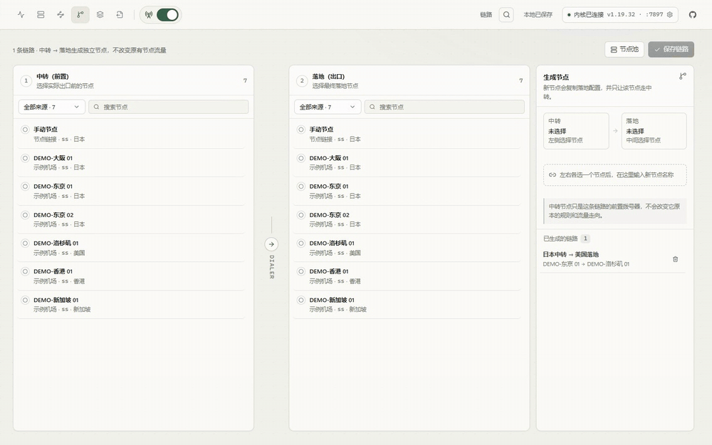

<div align="center">

# Clash RuleVis

**A local-first visual routing workbench for Clash Verge / mihomo**

See every request as **domain → rule → policy group → node**, then edit, reorder and validate the routing without hand-writing YAML.

[中文](README.md) · [English](README.en.md)

[](https://github.com/youbilin/Clash-RuleVis/actions/workflows/ci.yml)


</div>

<p align="center">
  
</p>

<p align="center">
  <sub>Demo data only. A chain node is a new independent proxy and does not reroute the relay or landing nodes.</sub>
</p>

---

> The local web workbench is stable. A Tauri 2 desktop preview now uses Rust for workspace storage, export and history, but subscription/YAML import and kernel integration are still being migrated. No Windows installer is published yet, and no Electron/Node sidecar is used as a stand-in.

## What it is

Clash routing is spread across subscriptions, policy groups, `rule-providers` and several YAML files. A rule edit often means guessing whether it matches, which policy group it uses, and which node actually carries the traffic.

Clash RuleVis is a local web workbench that connects to a running mihomo controller, shows the live path, lets you drag domains into rules, manage policy groups, and export a complete validated YAML.

**Safe mode is a product constraint, not a setting:**

- It never writes Clash Verge configuration or profiles.
- It never reloads the kernel.
- Exports are written only to the tool's own directory for manual import.
- Subscription URLs, node credentials and the controller secret stay on the local machine.

## Highlights

- **Live paths**: active connections, rates, traffic, processes, matched rule and final node; drag a domain onto an exit or a single node.
- **Chinese rule catalog**: all MetaCubeX `meta-rules-dat` geosite/geoip entries with Chinese names, recommended combos, lazy-loaded catalog and priority management in one list.
- **Batch imports**: one dialog accepts multiple subscription URLs, YAML payloads or node links; each row is auto-detected.
- **Node health**: single/all latency tests, persisted results, failed/disabled/duplicate filters, duplicate merge.
- **Visual chain proxy**: left relay + right landing generates a new independent node using `dialer-proxy`; original nodes are untouched.
- **Safe export**: full YAML, diff against previous export, real `verge-mihomo -t` validation, history dropdown with diff-aware restore.
- **Local data tools**: workspace JSON backup/restore, open export directory, copy Verge import steps.
- **Desktop-first layout**: dense lists, internally scrolling tables and no page-level scroll on long lists.

## Screenshots

<p align="center">
  
  
</p>
<p align="center">
  
  
</p>

<p align="center"><sub>Screenshots use the fake demo workspace; no real subscriptions or node addresses are included.</sub></p>

## Quick start

Requires Node.js 22+.

### Demo (fake data, no kernel required)

```bash
npm install
npm run demo
```

Open <http://127.0.0.1:4781>. The demo uses an isolated `.demo-data` directory and never reads or writes your `data/` workspace.

### Development

```bash
npm install
npm run dev
```

- UI: <http://127.0.0.1:5273>
- Local API: <http://127.0.0.1:4780>

### Production build

```bash
npm run build
npm start
```

Fastify serves `dist/` at <http://127.0.0.1:4780>.

## Tests

```bash
npm run typecheck
npm test
npm run test:e2e
npm run rust:test
npm run desktop:check
```

40 unit tests plus a Playwright smoke flow that imports nodes, merges duplicates, creates an exit, creates a chain node, cleans invalid rules, exports, restores history and round-trips a workspace backup. E2E uses a temporary data directory and local Chrome; set `CHROME_PATH` if needed.

## Desktop preview (Tauri 2)

The desktop shell runs the same React UI and talks to Rust over Tauri IPC; it does not start a local HTTP server or a Node sidecar. Its data lives in the platform app-data directory (`%APPDATA%\io.github.youbilin.clash-rulevis` on Windows, override with `CRS_DATA_DIR`) and is independent from the web build's `data/`. Windows builds need Rust stable, MSVC Build Tools with the C++ workload, Windows SDK 10 and the WebView2 runtime.

```bash
npm run desktop:dev    # Tauri window + Vite
npm run desktop:check  # Rust compile check for the shell
npm run desktop:build  # Desktop binary, no installer bundle yet
```

To migrate an existing web workspace, import its JSON backup from the desktop settings drawer. Implemented in the preview:

- Workspace load/save with revision conflicts, JSON backup import, history snapshots and restore.
- Manual share-link import, node/exit editing, chain creation/deletion, rule-catalog batch add.
- Full YAML preview, diff, safe export and open-export-directory.
- Read-only Clash Verge profile discovery for base port/DNS/TUN settings.
- Empty-state live polling without a WebSocket service.

Still to migrate: subscription/YAML import, source refresh, kernel controller and live stream, latency tests, ruleset refresh and `verge-mihomo -t` validation. These return an explicit `DESKTOP_UNAVAILABLE` error instead of failing silently.

## Rust core

`rust/rulevis-core` is the shared foundation for workspace normalization, YAML generation and share-link parsing. It currently covers:

- Workspace v2 serde models and the same normalization rules as the web app.
- The complete YAML generator, including exit resolution, providers, rule priority and validation issues / counts.
- SS, SSR, VMess, VLESS, Trojan, Hysteria2, TUIC and SOCKS5 links, including percent-encoded SS, Reality, ws/grpc and obfs.
- A small CLI with `check`, `generate`, `normalize` and `parse-link`.

The web build still uses Fastify; the desktop shell calls Rust directly. Parity tests use [fixtures](fixtures/README.md) as a language-independent contract and compare parsed YAML semantics, not indentation. `rust/rulevis-app` contains the testable desktop storage/export/API layer, while `src-tauri` only hosts the window and IPC command.

```bash
cd rust
cargo fmt --check
cargo clippy --workspace --all-targets -- -D warnings
cargo test --workspace
cargo run -p rulevis-core -- check ../demo/workspace.json
```

CI runs the Rust workspace tests, including the desktop API end-to-end cases. Building Windows installers later requires MSVC Build Tools, the Windows SDK and WebView2; no desktop installer is published yet.

## Data

Runtime data lives in `data/` by default:

```text
data/
├── workspace.json
├── history/
├── exports/
└── rule-sets/
```

Override it with `CRS_DATA_DIR`. `data/`, `.demo-data/` and exported files are excluded from git.

## Safety and privacy

- Binds `127.0.0.1` only, with a local session cookie and Origin allowlist.
- No telemetry or third-party analytics.
- Export YAML excludes subscription source URLs, `external-controller` and `secret`.
- Node credentials are intentionally present in exported YAML because the kernel needs them; treat exported files as secrets.
- Workspace backups contain subscription URLs and node credentials; keep them local.

See [SECURITY.md](SECURITY.md) for private vulnerability reporting.

## Roadmap

- **v0.2**: current local web workbench and complete import/rules/chain/export loop.
- **Rust foundation (done)**: `rulevis-core` covers normalization, config generation and link parsing; 20 Rust tests include fixture parity and desktop API end-to-end cases.
- **Desktop preview (current)**: Tauri 2 shell with the React UI; Rust now owns workspace storage, history, export, manual nodes, chains and rule-catalog batch add.
- **Next**: migrate subscription/YAML import, the kernel controller and live stream, latency tests and kernel validation, then publish signed Windows installers.
- **Later**: more protocols, proxy providers, tray, auto-update.
- A pure Rust UI rewrite is not a goal unless the WebView is proven to be the bottleneck.

## Contributing

See [CONTRIBUTING.md](CONTRIBUTING.md). Never commit `data/`, real subscription URLs, node credentials or exported YAML.

## License

[MIT](LICENSE).

If this tool saves you time, a Star, issue or pull request is welcome.
