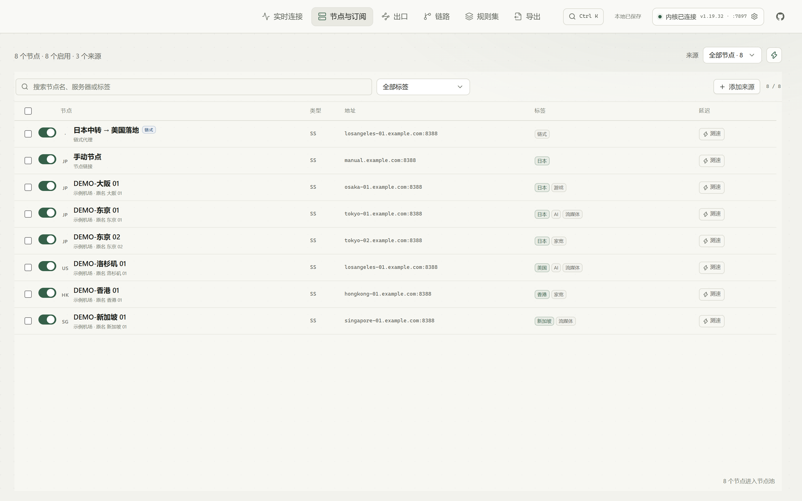
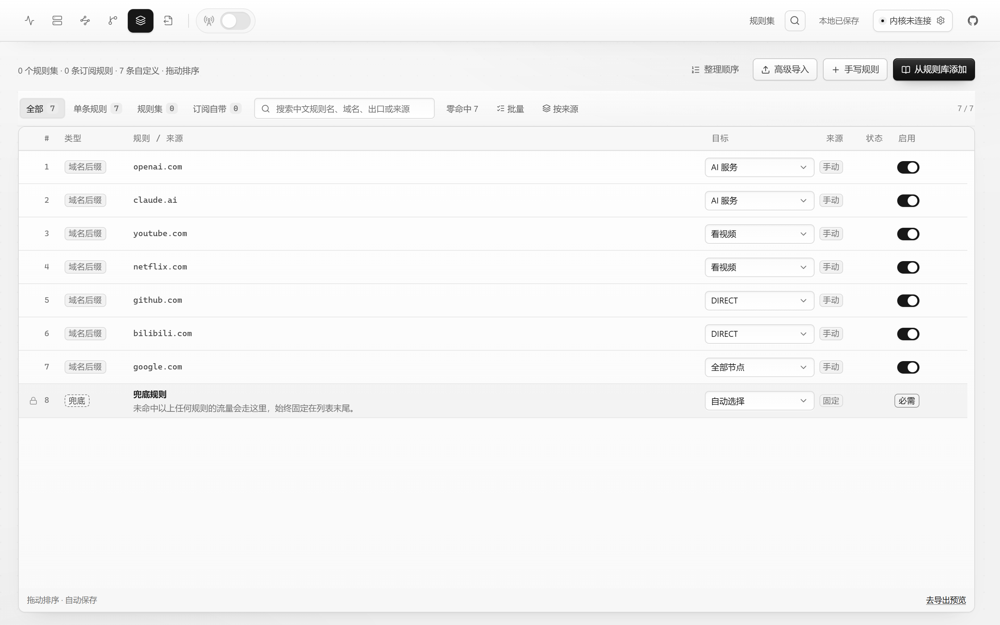
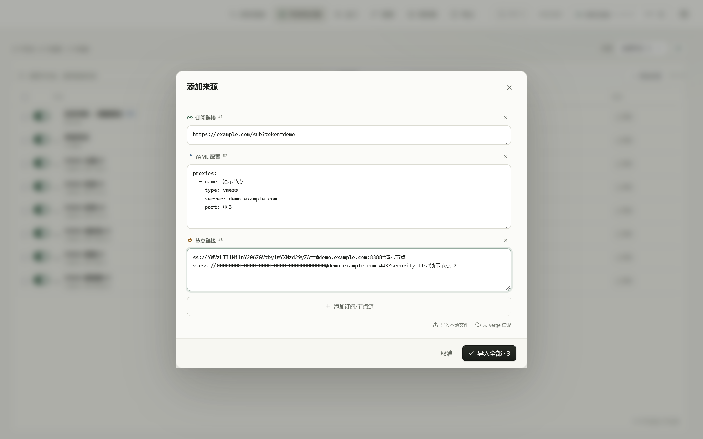
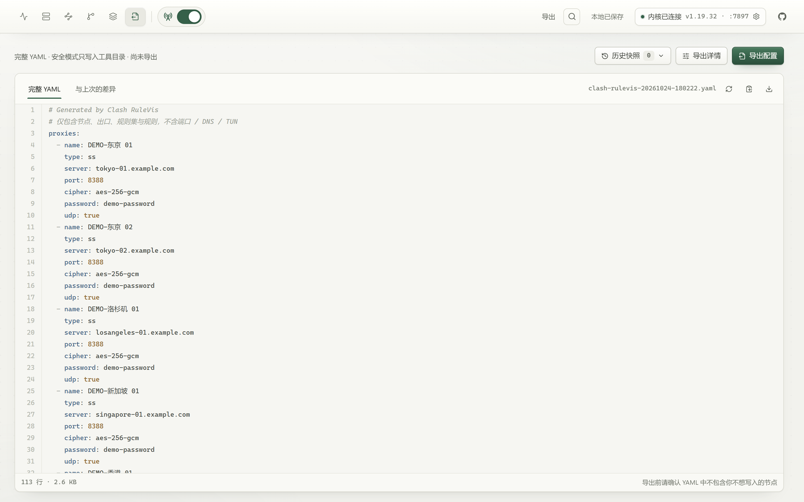
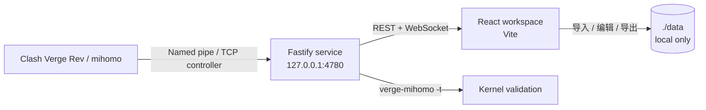

<div align="center">

# Clash RuleVis

**路由台 · 面向 Clash Verge / mihomo 的本地可视化规则工作台**

看清每一次访问的「域名 → 规则 → 出口 → 节点」，把复杂的分流配置变成可观察、可拖拽、可校验的工作流。

[中文](README.md) · [English](README.en.md)

[](https://github.com/youbilin/Clash-RuleVis/actions/workflows/ci.yml)


</div>

<p align="center">
  
</p>

<p align="center">
  <sub>演示数据均为假节点。链路编辑器生成的是独立节点，不会改变中转和落地节点原本的流量。</sub>
</p>

---

> 本地 Web 工作台与 Windows 桌面版均已可用。桌面版由 Tauri 2 + Rust 驱动，不启动 Node 服务，不使用 Electron 或 Node sidecar。当前安装包未做代码签名，Windows SmartScreen 可能提示未知发布者。

## 这是什么

Clash 的规则通常散落在订阅、策略组、`rule-providers` 和多份 YAML 中。改一条规则往往要猜：它是否命中、指向哪个出口、最后走了哪个节点。

**Clash RuleVis** 是一个只在本机运行的可视化路由工作台。它连接正在运行的 mihomo 控制器，实时展示访问路径，并允许你直接拖拽域名生成规则、管理出口、整理规则顺序，最后导出一份经过校验的完整 YAML。

它不是一个自动改写 Clash Verge 配置的工具。安全模式是产品的核心约束：

- 不修改 Clash Verge 的配置或 profile
- 不触发内核配置重载
- 导出文件只写入本工具目录，由你手动导入 Verge
- 控制器密钥与订阅信息只保存在本机

## 界面预览

<p align="center">
  
  
</p>
<p align="center">
  
  
</p>

<p align="center"><sub>截图使用 <code>demo/workspace.json</code> 中的演示数据，不包含真实订阅或节点地址。</sub></p>

## 主要能力

### 实时链路

- 通过 WebSocket 实时展示活跃连接、速率、流量和进程信息
- 展开任意一条连接，查看「域名 → 命中规则 → 出口策略组 → 最终节点」
- 支持同一域名的多个规则变体与命中次数
- 把域名直接拖到右侧**出口**或**节点**上，生成一条目标明确的新规则
- 暂停 / 继续实时流收在 STREAM 状态旁，不占用页面标题区
- 出口/节点标签和搜索固定，目标列表独立滚动

### 中文规则库

- 内置 MetaCubeX `meta-rules-dat` 的全量规则目录：**1920 条 geosite + 260 条 geoip**
- 常用服务、平台和地区提供中文名与简短说明
- 12 组推荐组合：AI、流媒体、海外社交、开发工具、Google、Telegram、国内直连、广告拦截、游戏平台、私有网络、Apple、微软
- 支持中文/英文/域名搜索、分类筛选、批量选择和指定目标出口
- 规则目录按需加载，不进入首屏主包

### 节点与来源

- 从节点工具栏的「添加来源」打开单层弹窗；一次可以添加多条来源，每行自动识别订阅链接、YAML 配置或节点链接，点下方 + 继续加
- 支持直接粘贴节点分享链接并自动识别：`ss://`（含百分号编码用户信息）、`ssr://`、`vmess://`、`vless://`、`trojan://`、`hysteria2://`、`tuic://`、`socks5://`
- 仍支持本地 YAML / 文本文件与直接读取 Clash Verge 当前配置
- Reality、obfs 等常用高级参数会随链接一并保留
- 点击节点行即勾选，不进入编辑；悬停右侧可编辑或删除节点
- 直链添加的节点统一归入「节点链接」来源；删除来源最后一个节点时来源一起移除
- 节点批量启用/禁用、标签管理、按来源筛选；关闭节点会自动从出口的直接成员中移除，避免阻塞导出
- 标签、来源筛选控件保持固定宽度，搜索框不会随筛选出现/消失而伸缩
- 单节点测速与全部测速；失败/禁用/重复节点组合筛选，支持一键合并重复配置
- 一键刷新全部订阅与 Verge 来源；显示最近更新、剩余流量和到期时间
- 最近一次测速结果保存在本地，刷新页面后仍可查看

### 链式代理

- 独立的「链路」页面：左侧选中转、右侧选落地，最右侧输入新节点名
- 节点可按来源（订阅、文件、节点链接等）筛选和搜索
- 生成的是一个**新的独立节点**，使用 mihomo `dialer-proxy` 指向前置中转；不会修改中转、落地节点的原有流量
- 新节点自动出现在节点池，可被出口和规则直接引用
- 中转节点失效或禁用时，导出校验会阻止继续导出
- 已生成的链路可单独删除，删除链路不会影响中转和落地节点

### 出口与规则

- 出口对应 mihomo 策略组，支持 `select`、`url-test`、`fallback`、`load-balance`
- 成员可以手选节点、按标签、按名称正则，或嵌套其他出口
- 出口行悬停可直接删除；引用它的规则/嵌套成员会一并处理，并自动创建可撤销快照
- 导出时静态展开成员，行为可预期，不依赖内核版本对 filter 语法的支持
- 规则优先级统一在一个列表中管理：拖动排序，单条规则、规则集和订阅规则按顺序匹配
- 支持按来源折叠、组内筛选、批量启用/停用/删除
- 规则集行内展示最近命中的域名和最终节点，可展开查看命中详情
- 支持筛选目标已失效或内核累计零命中的规则，一键清理失效目标
- 实时连接右键可快速生成「直连 / 拒绝 / 走收藏出口」规则

### 安全导出

- 自动合并 Verge 当前运行时基础设置（端口、DNS、TUN、sniffer 等），排除控制器与密钥
- 导出前进行引用、空出口、重复/遮蔽规则检查
- 可用 `verge-mihomo -t` 对完整配置做真实内核语法校验
- 生成完整 YAML、与上次导出的 diff、历史快照与一键恢复
- 历史快照收进顶栏下拉：选择快照、查看恢复前后差异、底部一键恢复
- 校验失败时自动打开导出详情并高亮错误
- YAML 占满工作区，代码区域独立滚动
- 导出前弹窗确认文件名，确认后才写入；完成后可直接导入 Clash Verge 或复制临时订阅地址
- 设置内显示导出文件数量与占用，可清理 30 天前且未被历史引用的 YAML

### 效率

- `Ctrl / Cmd + K` 全局命令面板，可跳转节点、出口、链路、规则、历史版本和设置
- 添加来源收进节点工具栏；单层弹窗内用多行输入批量添加，每行自动识别类型，导入完成即回节点表
- 无大标题、无大卡片，桌面与移动端都保持紧凑布局
- 长列表统一在内部滚动，页面本身不跟随列表滚动
- 工作区 JSON 备份 / 恢复（包含订阅地址与节点凭据，请只保存在本机）
- 本地会话 Cookie、Origin 白名单、仅监听 `127.0.0.1`

## 架构



- 前端：React 19、TypeScript strict、Vite 8、Zustand、dnd-kit、TanStack Virtual
- 后端：Fastify 5、WebSocket、YAML parser、undici
- 数据：本机 JSON 工作区 + 文件系统历史快照，不依赖数据库
- 内核：Windows 下自动枚举 mihomo 命名管道，也支持手动 TCP controller

## Rust 核心（迁移中）

`rust/rulevis-core` 是桌面版的内核地基，目前已经完成：

- Workspace v2 的 serde 模型与工作区规范化（手动来源合并、链路 `dialer-proxy` 同步、禁用节点成员清理、内置出口与 MATCH 修复）。
- YAML 生成器：节点、出口、规则集 provider、规则优先级、同名/空出口/嵌套环/覆盖规则等校验，issues 与 counts 和 TypeScript 版一致。
- 8 种分享链接解析：SS / SSR / VMess / VLESS / Trojan / Hysteria2 / TUIC / SOCKS5，包含 percent-encoded SS、Reality、ws/grpc、obfs 等参数。
- CLI：`check`、`generate`、`normalize`、`parse-link`。

Web 端仍使用 Fastify；桌面端通过 Tauri IPC 直接调用 Rust，不启动本地 HTTP 服务，也不带 Node sidecar。parity 测试以 [fixtures](fixtures/README.md) 为语言无关契约，YAML 比较的是解析后的语义结构而非缩进。

```bash
cd rust
cargo fmt --check
cargo clippy --workspace --all-targets -- -D warnings
cargo test --workspace
cargo run -p rulevis-core -- check ../demo/workspace.json
```

GitHub Actions 会运行 Rust 核心与桌面 API 测试，并在 Windows runner 上检查 Tauri 壳编译。`npm run desktop:build` 会生成 release 二进制与 NSIS 安装包。Windows 构建前置条件是 MSVC Build Tools、Windows SDK 和 WebView2。

## 下载安装（Windows）

从 [GitHub Releases](https://github.com/youbilin/Clash-RuleVis/releases/latest) 下载最新的 `Clash.RuleVis_x.x.x_x64-setup.exe`（NSIS，当前用户安装）。安装包未签名，SmartScreen 可能提示未知发布者；Release 页面会提供 SHA256，可自行校验。

桌面数据保存在 `%APPDATA%\io.github.youbilin.clash-rulevis`（可用 `CRS_DATA_DIR` 覆盖），与 Web 版的 `data/` 相互独立。首次使用可在设置中导入 Web 版工作区 JSON 备份。

## 桌面版（Tauri 2）

桌面版保留同一套 React UI，由 Rust 负责本地 API：

- 独立工作区存储、版本冲突、历史快照/恢复与工作区备份导入。
- 订阅链接、YAML 粘贴、本地文件和 Verge 当前 profile 导入；来源刷新、流量/到期信息。
- 手动节点链接、节点与出口编辑、链式代理、规则库批量添加、规则集文件/URL 检查与刷新。
- mihomo 控制器自动发现：TCP controller 与 Windows 命名管道；连接设置、重新探测、节点/出口测速。
- 实时连接聚合：域名、规则命中、出口/节点、进程、速率与历史曲线。
- 完整 YAML 预览、diff、真实 `verge-mihomo -t` 校验、安全导出与历史恢复。
- 一键导入 Clash Verge：导出后生成本机临时订阅地址，并调用 `clash://install-config` 触发 Verge 导入；也可复制地址手动添加。
- 只读读取 Verge 当前 profile 的端口 / DNS / TUN 等基础设置。

```bash
npm run desktop:dev    # 启动 Tauri 窗口 + Vite
npm run desktop:check  # Rust 编译检查
npm run desktop:build  # 构建 release + NSIS 安装包
```

Windows 构建前置：Rust stable、MSVC Build Tools 的 C++ 工作负载、Windows SDK 10、WebView2 Runtime；运行实时功能需要 Clash Verge Rev / mihomo。

安全边界与 Web 版一致：不直接写入 Verge 配置文件、不重载内核；订阅信息和控制器密钥不会出现在导出 YAML。桌面版平时只使用 Tauri IPC；点击「导入到 Clash Verge」时才会在 `127.0.0.1` 随机端口临时提供当前导出的 YAML，使用随机 token、30 分钟过期，随后点击/复制地址由 Verge 完成导入。当前安装包未签名，自动更新与代码签名属于下一阶段。

## 快速开始

### 环境

- Node.js 22+
- Windows 10/11（当前 Verge 命名管道探测以 Windows 为主；TCP 控制器可跨平台）
- Clash Verge Rev / mihomo（可选，离线也能编辑配置）

### 直接体验（假数据，无需节点）

```bash
npm install
npm run demo
```

访问 <http://127.0.0.1:4781>。演示使用独立的 `.demo-data` 和 `demo/workspace.json`，不会读写你的 `data/`，也不会上传任何信息。

### 开发

```bash
npm install
npm run dev
```

- Web UI：<http://127.0.0.1:5273>
- 本地 API：<http://127.0.0.1:4780>

### 生产构建

```bash
npm run build
npm start
```

生产模式由 Fastify 托管 `dist/`，访问 <http://127.0.0.1:4780>。

### 数据目录

默认数据保存在项目下的 `data/`：

```text
data/
├── workspace.json      # 工作区
├── history/            # 历史快照
├── exports/            # 导出的 YAML
└── rule-sets/          # 本地规则集缓存
```

可以通过环境变量 `CRS_DATA_DIR` 指定其他本地目录。`data/` 已在 `.gitignore` 中排除。

## 工作流

1. **导入节点**：订阅、YAML、节点链接，或直接读取 Verge 当前配置。
2. **建立出口**：把节点按用途组合成出口，例如「家宽」「AI 服务」「看视频」。
3. **添加规则**：从中文规则库选择组合，或在实时连接页把域名拖到出口/节点。
4. **整理优先级**：拖动排序，批量启停或删除，按来源折叠检查。
5. **导出**：查看完整 YAML 和 diff，运行内核校验，再手动导入 Clash Verge。

## 命令

```bash
npm run dev        # 同时启动 Fastify 与 Vite
npm run demo       # 构建后用演示数据启动生产版，访问 :4781
npm run dev:server # 仅启动本地 API
npm run dev:web    # 仅启动前端
npm run typecheck  # 前端 + 后端类型检查
npm test           # 40 项单元测试
npm run test:e2e   # 构建后用临时数据目录跑 Playwright 冒烟
npm run build      # 类型检查 + 生产构建
npm start          # 运行生产服务
npm run rust:test  # Rust 核心 + 桌面 API 测试
npm run rust:lint  # Rust fmt + clippy
npm run desktop:dev   # Tauri 2 桌面版
npm run desktop:check # 桌面壳编译检查
npm run desktop:build # release + NSIS 安装包
```

`test:e2e` 会使用系统临时数据目录和本机 Chrome 跑一次完整冒烟，不触碰当前 `data/`；如果 Chrome 不在默认位置，可设置 `CHROME_PATH`。

## 项目结构

```text
src/
├── components/        # 公共组件、导入器、规则目录、命令面板
├── pages/             # 实时连接、节点、出口、链路、规则集、导出
├── store/             # 工作区、实时数据、UI 状态
├── lib/               # 节点链接解析、撤销、格式化
├── data/              # 生成的 MetaCubeX 规则目录
└── styles/            # Design tokens 与最终样式层
server/
├── app.ts             # API 与 WebSocket
├── aggregator.ts      # 连接流聚合
├── kernel.ts          # mihomo 控制器适配
├── exporter.ts        # YAML 导出
├── mihomo-validator.ts# 真实内核校验
├── generator.ts       # 配置生成与校验
└── tests/             # node:test 单元测试
tests/e2e/             # Playwright 临时目录冒烟测试
demo/                  # 无敏感数据的演示工作区
docs/assets/           # README 截图与演示 GIF
shared/                # 前后端共享类型与解析模型
scripts/               # 规则目录、演示与截图脚本
rust/rulevis-core/     # 工作区规范化、YAML 生成、链接解析
rust/rulevis-app/      # 桌面存储、历史、导出与 API（可独立测试）
src-tauri/             # Tauri 2 壳，仅负责窗口与 IPC
fixtures/              # TypeScript ↔ Rust 的 parity 契约
```

## Roadmap

- **v0.2**：本地 Web 工作台、完整规则/出口/链路/导出闭环、自动刷新与备份。
- **v0.3（当前）**：Tauri 2 + Rust 桌面版；订阅/YAML 导入、内核 TCP/命名管道、实时连接、测速、规则集、mihomo 校验与 NSIS 安装包全部落地。
- **Rust 地基**：`rulevis-core` 与 `rulevis-app` 共 27 项测试，包含 fixture 语义对齐、订阅抓取、桌面 API 与真实控制器冒烟。
- **下一步**：代码签名、自动更新、桌面托盘、多跳链路与 Proxy Provider。
- **边界**：安装包目前只提供 Windows x64；不会用 Electron 或 Node sidecar 冒充桌面版。
- **再评估**：只有在 WebView 被证明是瓶颈时，才考虑用 Rust 重写 UI；纯 Rust UI 不是当前目标。

## 已知边界

- 当前只负责生成配置，不自动写入 Verge 或重载内核，这是安全模式的有意取舍。
- 订阅不会在后台持续自动刷新；可手动刷新单个来源或一键刷新全部。
- 链路编辑器当前生成单跳链式节点，不支持把链式节点再次作为中转或落地。
- Windows 命名管道自动发现优先支持 Clash Verge Rev；其他内核可通过 TCP controller 手动连接。
- 规则目录来自 MetaCubeX，冷门条目可能保留上游英文名。
- Windows 安装包目前未签名，且只提供 x64；实时连接、测速需要本机运行 Clash Verge Rev / mihomo。

## 数据与隐私

- 所有数据、订阅地址、节点信息与控制器密钥都只保存在本机。
- Web 服务仅监听 `127.0.0.1`，并使用本地会话 Cookie 与 Origin 白名单；桌面版平时只用 Tauri IPC，导入 Verge 时才临时监听随机回环端口。
- 临时分享链接使用随机 token，30 分钟有效，仅提供当前导出的 YAML。
- 不发送遥测，不接入第三方分析服务。
- 导出的 YAML 不包含 `external-controller` 与 `secret`。
- 桌面版工作区、历史、导出和密钥设置保存在应用数据目录，请按敏感数据保管。

## 许可证与参与

- 代码以 [MIT](LICENSE) 许可发布。
- 安全报告请走 [SECURITY.md](SECURITY.md)，不要在公开 issue 粘贴真实订阅、节点凭据或控制器 secret。
- 开发约定和本地检查见 [CONTRIBUTING.md](CONTRIBUTING.md)，版本变化见 [CHANGELOG.md](CHANGELOG.md)。

## 致谢

- [linux.do](https://linux.do/) — 中文技术社区，感谢社区提供的交流、反馈与推广支持
- [MetaCubeX/meta-rules-dat](https://github.com/MetaCubeX/meta-rules-dat) — geosite / geoip 规则数据
- [MetaCubeX/mihomo](https://github.com/MetaCubeX/mihomo) — 内核与控制器 API
- [Clash Verge Rev](https://github.com/clash-verge-rev/clash-verge-rev) — 运行时配置与使用场景
- React、Vite、Fastify、dnd-kit、TanStack Virtual、lucide-react

---

如果这个项目对你有帮助，欢迎 Star、提 Issue 或提交 PR。安全、本地优先的 Clash 工具值得被更多人看见。
