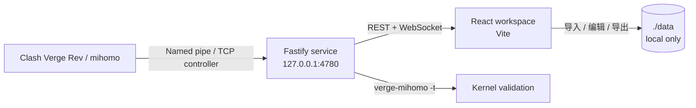

<div align="center">

# Clash RuleVis

**路由台 · 面向 Clash Verge / mihomo 的本地可视化规则工作台**

看清每一次访问的「域名 → 规则 → 出口 → 节点」，把复杂的分流配置变成可观察、可拖拽、可校验的工作流。


</div>

---

## 这是什么

Clash 的规则通常散落在订阅、策略组、`rule-providers` 和多份 YAML 中。改一条规则往往要猜：它是否命中、指向哪个出口、最后走了哪个节点。

**Clash RuleVis** 是一个只在本机运行的可视化路由工作台。它连接正在运行的 mihomo 控制器，实时展示访问路径，并允许你直接拖拽域名生成规则、管理出口、整理规则顺序，最后导出一份经过校验的完整 YAML。

它不是一个自动改写 Clash Verge 配置的工具。安全模式是产品的核心约束：

- 不修改 Clash Verge 的配置或 profile
- 不触发内核配置重载
- 导出文件只写入本工具目录，由你手动导入 Verge
- 控制器密钥与订阅信息只保存在本机

## 主要能力

### 实时链路

- 通过 WebSocket 实时展示活跃连接、速率、流量和进程信息
- 展开任意一条连接，查看「域名 → 命中规则 → 出口策略组 → 最终节点」
- 支持同一域名的多个规则变体与命中次数
- 把域名直接拖到右侧**出口**或**节点**上，生成一条目标明确的新规则
- 出口/节点标签和搜索固定，目标列表独立滚动

### 中文规则库

- 内置 MetaCubeX `meta-rules-dat` 的全量规则目录：**1920 条 geosite + 260 条 geoip**
- 常用服务、平台和地区提供中文名与简短说明
- 12 组推荐组合：AI、流媒体、海外社交、开发工具、Google、Telegram、国内直连、广告拦截、游戏平台、私有网络、Apple、微软
- 支持中文/英文/域名搜索、分类筛选、批量选择和指定目标出口
- 规则目录按需加载，不进入首屏主包

### 节点与来源

- 支持订阅链接、本地 YAML、粘贴配置、Clash Verge 当前配置
- 支持直接粘贴节点分享链接并自动识别：`ss://`、`vmess://`、`vless://`、`trojan://`、`hysteria2://`、`tuic://`
- Reality、obfs 等常用高级参数会随链接一并保留
- 节点批量启用/禁用、标签管理、按来源筛选
- 单节点测速与全部测速；失败节点标红，并支持「只看失败」
- 最近一次测速结果保存在本地，刷新页面后仍可查看

### 出口与规则

- 出口对应 mihomo 策略组，支持 `select`、`url-test`、`fallback`、`load-balance`
- 成员可以手选节点、按标签、按名称正则，或嵌套其他出口
- 导出时静态展开成员，行为可预期，不依赖内核版本对 filter 语法的支持
- 规则优先级统一在一个列表中管理：拖动排序，单条规则、规则集和订阅规则按顺序匹配
- 支持按来源折叠、组内筛选、批量启用/停用/删除
- 规则集行内展示最近命中的域名和最终节点，可展开查看命中详情

### 安全导出

- 自动合并 Verge 当前运行时基础设置（端口、DNS、TUN、sniffer 等），排除控制器与密钥
- 导出前进行引用、空出口、重复/遮蔽规则检查
- 可用 `verge-mihomo -t` 对完整配置做真实内核语法校验
- 生成完整 YAML、与上次导出的 diff、历史快照与一键恢复
- 校验失败时自动打开导出详情并高亮错误
- YAML 占满工作区，代码区域独立滚动

### 效率

- `Ctrl / Cmd + K` 全局命令面板，可跳转节点、出口、规则、历史版本和设置
- 页面内嵌导入，不再弹出层层对话框
- 无大标题、无大卡片，桌面与移动端都保持紧凑布局
- 本地会话 Cookie、Origin 白名单、仅监听 `127.0.0.1`

## 架构



- 前端：React 19、TypeScript strict、Vite 8、Zustand、dnd-kit、TanStack Virtual
- 后端：Fastify 5、WebSocket、YAML parser、undici
- 数据：本机 JSON 工作区 + 文件系统历史快照，不依赖数据库
- 内核：Windows 下自动枚举 mihomo 命名管道，也支持手动 TCP controller

## 快速开始

### 环境

- Node.js 22+
- Windows 10/11（当前 Verge 命名管道探测以 Windows 为主；TCP 控制器可跨平台）
- Clash Verge Rev / mihomo（可选，离线也能编辑配置）

### 开发

```bash
npm install
npm run dev
```

- Web UI：<http://127.0.0.1:5273>
- 本地 API：<http://127.0.0.1:4780>

### 生产构建

```bash
npm run build
npm start
```

生产模式由 Fastify 托管 `dist/`，访问 <http://127.0.0.1:4780>。

### 数据目录

默认数据保存在项目下的 `data/`：

```text
data/
├── workspace.json      # 工作区
├── history/            # 历史快照
├── exports/            # 导出的 YAML
└── rule-sets/          # 本地规则集缓存
```

可以通过环境变量 `CRS_DATA_DIR` 指定其他本地目录。`data/` 已在 `.gitignore` 中排除。

## 工作流

1. **导入节点**：订阅、YAML、节点链接，或直接读取 Verge 当前配置。
2. **建立出口**：把节点按用途组合成出口，例如「家宽」「AI 服务」「看视频」。
3. **添加规则**：从中文规则库选择组合，或在实时连接页把域名拖到出口/节点。
4. **整理优先级**：拖动排序，批量启停或删除，按来源折叠检查。
5. **导出**：查看完整 YAML 和 diff，运行内核校验，再手动导入 Clash Verge。

## 命令

```bash
npm run dev        # 同时启动 Fastify 与 Vite
npm run dev:server # 仅启动本地 API
npm run dev:web    # 仅启动前端
npm run typecheck  # 前端 + 后端类型检查
npm test           # 34 项单元测试
npm run build      # 类型检查 + 生产构建
npm start          # 运行生产服务
```

## 项目结构

```text
src/
├── components/        # 公共组件、导入器、规则目录、命令面板
├── pages/             # 实时连接、节点、出口、规则集、导出
├── store/             # 工作区、实时数据、UI 状态
├── lib/               # 节点链接解析、撤销、格式化
├── data/              # 生成的 MetaCubeX 规则目录
└── styles/            # Design tokens 与最终样式层
server/
├── app.ts             # API 与 WebSocket
├── aggregator.ts      # 连接流聚合
├── kernel.ts          # mihomo 控制器适配
├── exporter.ts        # YAML 导出
├── mihomo-validator.ts# 真实内核校验
├── generator.ts       # 配置生成与校验
└── tests/             # node:test 单元测试
shared/                # 前后端共享类型与解析模型
scripts/               # 规则目录生成脚本
```

## 已知边界

- 当前只负责生成配置，不自动写入 Verge 或重载内核，这是安全模式的有意取舍。
- 订阅不会在后台持续自动刷新；需要手动刷新来源。
- Windows 命名管道自动发现优先支持 Clash Verge Rev；其他内核可通过 TCP controller 手动连接。
- 规则目录来自 MetaCubeX，冷门条目可能保留上游英文名。

## 数据与隐私

- 所有数据、订阅地址、节点信息与控制器密钥都只保存在本机。
- 服务仅监听 `127.0.0.1`，并使用本地会话 Cookie 与 Origin 白名单。
- 不发送遥测，不接入第三方分析服务。
- 导出的 YAML 不包含 `external-controller` 与 `secret`。

## 致谢

- [MetaCubeX/meta-rules-dat](https://github.com/MetaCubeX/meta-rules-dat) — geosite / geoip 规则数据
- [MetaCubeX/mihomo](https://github.com/MetaCubeX/mihomo) — 内核与控制器 API
- [Clash Verge Rev](https://github.com/clash-verge-rev/clash-verge-rev) — 运行时配置与使用场景
- React、Vite、Fastify、dnd-kit、TanStack Virtual、lucide-react

---

如果这个项目对你有帮助，欢迎 Star、提 Issue 或提交 PR。
